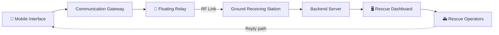
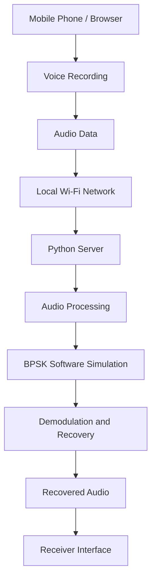

# 🛟 ResQMesh 

It is a communication technique when an unexpected disaster was carried out !
Communication is the only medium which can act as a bridge between rescue operator and the victim. What is the communication has been become a Disaster!!

To solve this issue, we just implemented a plan which can help to manage and resolve this serious issue. For this a pragmatic approach is required. So we developed a communication system "mobile with walkie talkie communication".
I just seem funny right? but we just came that live. The project is now at initial phase. When builds a communication network which will be only active during disaster.
---
 
> **During a disaster, communication should never become another obstacle to rescue.**
 
ResQMesh is our attempt to rethink emergency communication. When towers go down and networks fail, people still need a way to say *"we're here, we need help."* We are exploring how a mobile app, digital signal processing, radio links, and an elevated floating relay can work together to carry that message to rescuers.
 
> ⚠️ **Honest status:** ResQMesh is an early-stage project. What exists today is a **working software prototype**. The floating relay and physical radio link are **design concepts** that still need hardware, safety evaluation, and real-world testing. We've been careful to mark what is built and what is not.
 
---
 
## 📖 Table of Contents
 
1. [The Big Idea](#-the-big-idea)
2. [How the Proposed System Works](#-how-the-proposed-system-works)
3. [Why a Floating Relay?](#-why-a-floating-relay)
4. [What We Have Built So Far](#-what-we-have-built-so-far)
5. [How Data Travels in the Prototype](#-how-data-travels-in-the-prototype)
6. [From Prototype to Floating Relay](#-from-prototype-to-floating-relay)
7. [Other Planned Modules](#-other-planned-modules)
8. [Technology Stack](#-technology-stack)
9. [Development Status](#-development-status)
10. [What's Next](#-whats-next)
11. [Our Vision](#-our-vision)
---
 
## 💡 The Big Idea
 
In a flood, cyclone, or earthquake, the first thing to fail is often the thing people need most: **communication**. Cell towers lose power, roads are blocked, and the people who most need help can't reach anyone.
 
ResQMesh asks a simple question:
 
> *What if we lifted the communication equipment above the damage?*
 
---
 
## 🔄 How the Proposed System Works
 
Here is the full journey of a message in the system we are working towards:
 
1. A person opens the **ResQMesh mobile interface** and sends a voice message or emergency request.
2. Their phone connects to a nearby **communication gateway**.
3. The gateway passes the information to the **floating relay** over a suitable wireless connection.
4. The floating unit sends it onward through an **RF link** to another receiving station.
5. The **receiving station** hands the recovered information to the **ground server**.
6. The **backend** processes it and makes it available to authorized **rescue operators**.
7. Operators respond and coordinate help.
And it works in **both directions**. Rescue operators can send messages back along the same path to the people who need them.
 

 
> The exact hardware, wireless access method, radio frequency, and communication protocol will be finalized in later development stages.
 
---
 
## 🎈 Why a Floating Relay?
 
Disasters damage infrastructure, and the terrain itself gets in the way. Buildings, hills, and damaged roads all weaken ground-level wireless signals.
 
Our idea is to go **up**. A **tethered balloon or aerostat** could carry antennas and radio equipment above those obstacles.
 
**Potential advantages**
 
- Better line-of-sight communication in suitable terrain
- An elevated point for relaying signals
- Possible communication support for isolated areas
- Deployable infrastructure for emergency operations
**Reality check:** actual coverage depends on antenna height, frequency, transmit power, antenna characteristics, terrain, interference, and more. The floating relay is currently a **design concept** and needs hardware development, safety evaluation, and practical testing.
 
---
 
## 🧪 What We Have Built So Far
 
We didn't want ResQMesh to stay a nice diagram. So we started by building a **software prototype** to learn how voice can be transmitted, processed, and recovered.
 
Our first implementation is a **mobile-to-server voice communication system**.
 
**Current prototype components**
 
- A browser-based voice recording interface
- A Python server that receives audio from a client
- Local network communication between devices
- WAV audio processing
- Software-based **BPSK** modulation and demodulation
- A simulated communication channel
- Audio reconstruction on the receiving side

 
In plain words: the phone's browser records audio and sends it over local Wi-Fi to a Python server. The server runs it through a software BPSK simulation and rebuilds the audio for the receiver to play back.
 
> 🚧 **This is not yet a physical radio communication system.**
 
---
 
## 🔍 How Data Travels in the Prototype
 
Here is the step-by-step flow, from your voice to the receiver's speaker.
 
| Step | What happens |
|------|--------------|
| **1. Voice capture** | The user records a message in the mobile browser, using its microphone access. |
| **2. Audio conversion** | The recording becomes a WAV file: **16,000 Hz**, **mono**, **16-bit**. |
| **3. Wireless transfer** | The browser sends the audio to the Python server by **HTTP over the local network**. Both devices must be on a reachable network. |
| **4. Server processing** | The server receives the audio and processes it with **NumPy** and **SciPy**. |
| **5. BPSK simulation** | Audio samples are turned into binary data, mapped to BPSK symbols, sent through a simulated channel with added noise, then demodulated and recovered bit by bit. |
| **6. Audio reconstruction** | The recovered bits are converted back to audio samples and saved as a WAV file. |
| **7. Playback** | The receiver interface requests the processed audio from the server and plays it. |
 
**What is BPSK?** Binary Phase Shift Keying represents 0s and 1s using two carrier phase states that are **180° apart**.
 
> **Important distinction:** Right now, audio travels over **local Wi-Fi**. BPSK is **simulated in software** after the server receives the audio. **No actual RF signal is transmitted through an antenna yet.**
 
---
 
## 🚀 From Prototype to Floating Relay
 
The prototype teaches us the software side. The next big challenge is replacing the local-network link with a real **radio link**.
 
**Today**
 
```
Mobile Browser
      |
      |  Local Wi-Fi
      |
Python Server
      |
Software BPSK Simulation
      |
Recovered Audio
```
 
**Where we are heading**
 
```
Mobile Interface
      |
Communication Gateway
      |
Floating Relay Unit
      |
Physical RF Transmission
      |
Ground Receiving Station
      |
Backend Server
      |
Emergency Control Dashboard
      |
Rescue Operator
```
 
The future system will need suitable radio hardware, antennas, a compatible protocol, and testing in a **legally permitted frequency band**.
 
A note on phones and radios: implementing BPSK in software does **not** mean a phone can automatically talk to an SDR. We will need a compatible **radio gateway or interface** to connect the mobile app to the RF system.
 
---
 
## 🧩 Other Planned Modules
 
ResQMesh is about more than voice. These modules are planned and will be built and integrated step by step.
 
### 🆘 SOS and Rescue Coordination
Citizens can submit an SOS with emergency details and available location information. A control-room dashboard lets authorized operators review incidents, assign rescue teams, track progress, and confirm safety.
 
### 🌦️ Weather Intelligence
Rainfall, temperature, humidity, wind speed, precipitation probability, and weather warnings, so authorities can understand conditions in affected regions.
 
### 🔋 Ultra Battery Saver
An emergency-focused mobile interface with quick access to essential apps and battery-saving settings for when charging isn't available.
 
---
 
## 🛠️ Technology Stack
 
| Component | Technology |
|-----------|------------|
| Mobile interface | HTML, CSS, JavaScript |
| Backend server | Python |
| Audio recording | Browser MediaRecorder |
| Audio processing | NumPy, SciPy |
| Audio format | WAV |
| Current networking | Local Wi-Fi / HTTP(S) |
| Digital modulation | BPSK software simulation |
| Future radio communication | SDR hardware |
| Future signal processing | GNU Radio |
| Proposed dashboard | React |
| Proposed database | PostgreSQL / Firebase |
| Proposed weather integration | Weather API |
| Proposed Android module | Kotlin / Android Studio |
 
---
 
## 📊 Development Status
 
| Feature | Status |
|---------|--------|
| Browser-based voice recording | ✅ Implemented in prototype |
| Python voice server | ✅ Implemented in prototype |
| Local Wi-Fi audio transfer | ✅ Demonstrated |
| WAV audio processing | ✅ Implemented in prototype |
| BPSK software simulation | ✅ Demonstrated |
| Simulated channel and noise | ✅ Demonstrated |
| Audio demodulation and reconstruction | ✅ Demonstrated |
| Floating communication relay | 💭 Proposed |
| Physical SDR transmission | ❌ Not implemented |
| Antenna-based RF communication | ❌ Not implemented |
| SOS and rescue dashboard | 📝 Planned |
| Weather intelligence | 📝 Planned |
| Ultra Battery Saver | 📝 Planned |
 
---
 
## 🗺️ What's Next
 
Our next stages are about taking ResQMesh beyond software simulation:
 
- [ ] Improve the current voice communication prototype
- [ ] Implement reliable sender-to-receiver message delivery
- [ ] Design a gateway between mobile devices and radio equipment
- [ ] Select suitable SDR transmitter and receiver hardware
- [ ] Build a physical BPSK transmission and reception pipeline
- [ ] Design and test suitable antennas
- [ ] Develop the floating relay communication unit
- [ ] Establish relay-to-ground-station communication
- [ ] Build the SOS reporting and emergency dashboard
- [ ] Integrate weather information
- [ ] Develop the Android emergency interface
- [ ] Run controlled end-to-end tests
---
 
## 🌍 Our Vision
 
We want to explore a communication system that can be deployed when conventional infrastructure becomes unreliable.
 
ResQMesh brings together mobile technology, digital signal processing, radio communication, elevated relay infrastructure, and disaster-response coordination. We're starting small with a software prototype, learning and validating each stage, and working step by step towards something that can support real rescue operations.
 
**Because during a disaster, communication should never become another obstacle to rescue.** 💙
 
