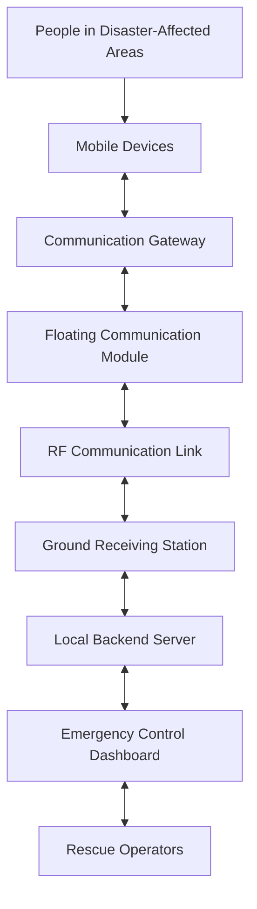
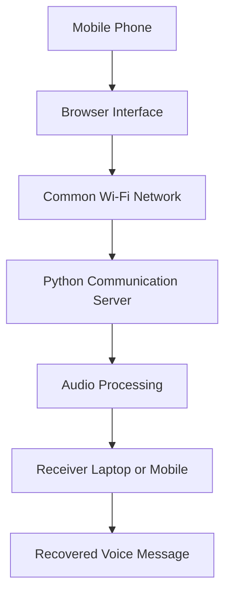
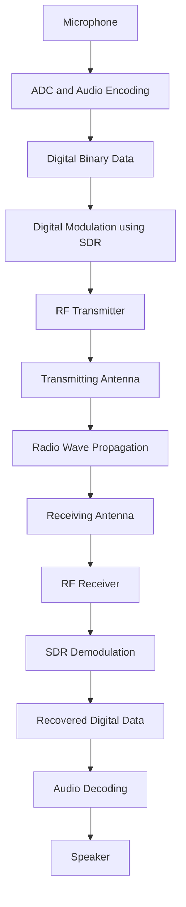

# 🛟 ResQMesh 

It is a communication technique when an unexpected disaster was carried out !
Communication is the only medium which can act as a bridge between rescue operator and the victim. What if the communication itself become a Disaster!!

To solve this issue, we just implemented a plan which can help to manage and resolve this serious issue. For this a pragmatic approach is required. So we developed a communication system "mobile with walkie talkie communication".
I just seem funny right? but we just came that live. The project is now at initial phase. When builds a communication network which will be only active during disaster.

# ResQMesh – Smart Disaster Rescue and Coordination System

> **Current Implementation:** We have developed a Python-based communication server that enables a mobile phone and a laptop to communicate over a common Wi-Fi network. The Python server acts as an intermediary, allowing the devices to exchange voice messages through a local network. This is our initial software prototype, developed to demonstrate the basic concept of communication between multiple devices.

> **Future Scope:** Our vision is to develop a dedicated communication network that allows multiple devices to communicate with each other, similar to walkie-talkies, without depending on conventional mobile networks or internet connectivity. The proposed system will use dedicated radio transmitter and receiver hardware, Software-Defined Radio (SDR) technology for digital signal modulation and demodulation, and antennas to transmit and receive Radio Frequency (RF) signals. We also propose a water-based floating communication module, designed like an inflatable swimming tube with a 3-metre antenna mast, to act as an additional communication relay during disaster situations.

> ⚠️ **Development Status:** The current implementation is a software-based Wi-Fi communication prototype. Dedicated radio communication, SDR hardware integration, RF transmission, and the floating communication module are future development goals.

---

## 📖 Table of Contents

1. [The Big Idea](#-the-big-idea)
2. [How the Proposed System Works](#-how-the-proposed-system-works)
3. [Why a Floating Relay?](#-why-a-floating-relay)
4. [What We Have Built So Far](#-what-we-have-built-so-far)
5. [How Data Travels in the Prototype](#-how-data-travels-in-the-prototype)
6. [From Prototype to Floating Relay](#-from-prototype-to-floating-relay)
7. [Other Planned Modules](#-other-planned-modules)
8. [Technology Stack](#-technology-stack)
9. [Development Status](#-development-status)
10. [What's Next](#-whats-next)
11. [Our Vision](#-our-vision)

---

## 💡 The Big Idea

Communication is one of the most critical requirements during a disaster. When floods, landslides, earthquakes, or other emergencies occur, conventional communication infrastructure can become unavailable due to damaged mobile towers, power failures, or network congestion.

But what happens when the communication system itself becomes a problem?

ResQMesh aims to explore an alternative communication infrastructure that can help people exchange emergency information even when conventional communication networks are unavailable.

The project follows two development stages:

### Stage 1 – Software Communication Prototype

A Python server connects a mobile phone and a laptop over a common Wi-Fi network, demonstrating basic voice-message communication.

### Stage 2 – Dedicated Radio Communication Network

Develop a hardware-based communication system using SDR technology, radio transmitters, receivers, and antennas to enable communication between multiple devices without depending on conventional cellular infrastructure.

The long-term concept also includes a floating communication relay that can be deployed on suitable water bodies during disaster situations.

---

## 🌐 How the Proposed System Works

The proposed system consists of mobile devices, communication gateways, a floating radio relay, and a ground receiving station.

### Proposed Communication Architecture

### Explanation of Each Component

1. **Mobile Devices:** People use their mobile phones to send emergency messages or voice communications.
2. **Communication Gateway:** Provides an interface between mobile devices and the dedicated radio communication system.
3. **Floating Communication Module:** Acts as a proposed intermediate communication relay deployed on water.
4. **RF Communication Link:** Carries information through radio-frequency electromagnetic waves.
5. **Ground Receiving Station:** Receives radio transmissions and forwards the recovered information to the local backend.
6. **Local Backend Server:** Processes and manages incoming communication data.
7. **Emergency Control Dashboard:** Allows authorized rescue operators to view and coordinate emergency communication.

The proposed architecture is not yet implemented. The exact radio links, gateway hardware, and communication protocols will be determined during development.

---

## 🌊 Why a Floating Relay?

One of the proposed components of ResQMesh is a compact floating communication module.

Unlike an aerial balloon or a large boat, this module is envisioned as an inflatable floating structure similar to a swimming tube, with a central equipment enclosure and a vertical antenna mast approximately 3 metres high.

### Proposed Physical Components

- **Floating Body:** Provides buoyancy and keeps the communication module on the water surface.
- **Waterproof Electronics Enclosure:** Protects the radio equipment, controller, and battery.
- **Antenna Mast:** Supports the antenna above the water surface.
- **SDR Equipment:** Handles radio signal processing, including modulation and demodulation.
- **Power Supply:** Provides energy to the communication equipment.
- **Anchoring Mechanism:** Helps keep the module in its intended deployment location.

### Why Use a Floating Module?

- Provides an additional communication point in suitable water-based disaster environments.
- Can potentially improve radio coverage through an elevated antenna position.
- Provides a platform for deploying radio equipment in areas where conventional infrastructure is damaged.
- Can potentially connect isolated communication gateways with a ground receiving station.

**Engineering Considerations:** The floating structure must remain stable under wind and water movement. The mast needs suitable structural support, and the electronics require marine-grade waterproofing. Communication range will depend on frequency, antenna design, height, transmit power, and environmental conditions.

---

## 🛠️ What We Have Built So Far

Our initial implementation focuses on establishing communication between two devices using a Python-based server.

### Current Prototype Components

| Component | Purpose |
|---|---|
| Python Server | Handles communication between devices |
| Laptop | Runs the local server |
| Mobile Phone | Acts as a voice-message sender or receiver |
| Common Wi-Fi Network | Provides connectivity between devices |
| Browser Interface | Provides the communication interface |
| Audio Processing | Handles recorded and recovered voice data |

### What the Prototype Demonstrates

- Establishing communication between a laptop and a mobile phone.
- Connecting devices through a common Wi-Fi network.
- Sending voice recordings to a Python server.
- Processing audio data through the server.
- Making audio available to the receiving device.

This implementation validates the initial software communication workflow. It is not yet a standalone walkie-talkie or an infrastructure-independent radio communication system.

---

## 🔄 How Data Travels in the Prototype

The current prototype follows a simple client-server communication architecture.

### Prototype Communication Flow

### Step-by-Step Explanation

1. A user records a voice message using the mobile browser.
2. The browser sends the recorded audio to the Python server.
3. The Python server receives and processes the audio.
4. The processed audio is made available to the receiving device.
5. The receiver retrieves and plays the voice message.

Both devices must be connected to a reachable common network.

### Important Distinction

The current prototype uses Wi-Fi communication. It does not transmit audio through a dedicated SDR transmitter or a physical RF antenna.

---

## 📡 From Prototype to Floating Relay

The next major development stage is to move from Wi-Fi-based communication to a dedicated radio communication system.

To understand this, we need to understand the main technologies involved.

### 1. Digital Voice Communication

When a person speaks, the microphone captures sound waves and converts them into an electrical audio signal.

An Analog-to-Digital Converter (ADC) converts that signal into digital samples.

These samples can then be encoded into binary data (0s and 1s) for digital communication.

### 2. Digital Modulation

Digital modulation is the process of representing digital information using changes in a radio carrier signal.

For example, **BPSK (Binary Phase Shift Keying)** represents binary information using two different carrier phases, separated by 180 degrees.

The transmitter maps the digital bits into modulated symbols before sending them through the radio system.

### 3. SDR – Software-Defined Radio

SDR stands for **Software-Defined Radio**.

Traditional radio devices use dedicated hardware circuits for many radio functions. SDR moves several of these functions into software, providing flexibility to configure and experiment with different communication techniques.

In ResQMesh, SDR is proposed for:

- Digital modulation at the transmitter.
- Generating and processing radio signals.
- Receiving RF signals.
- Demodulating received signals.
- Recovering the transmitted digital information.

SDR hardware still requires suitable RF front-end components, including frequency conversion and amplification where necessary.

### 4. Radio Transmitter

A radio transmitter converts the processed information into a suitable RF signal and sends it through an antenna.

The general process is:

`Digital Data → Modulation → RF Signal Generation → Antenna → Radio Transmission`

### 5. Radio Receiver

A radio receiver captures incoming radio signals through its receiving antenna and processes them to recover the transmitted information.

The general process is:

`Receiving Antenna → RF Front End → SDR Processing → Demodulation → Recovered Digital Data`

### 6. Antenna and RF Communication

RF stands for **Radio Frequency**.

Radio waves are electromagnetic waves used for wireless communication.

An antenna converts electrical RF signals into electromagnetic waves during transmission. During reception, it converts incoming electromagnetic waves into electrical signals that can be processed by the receiver.

The antenna does not independently decode the information. The receiver and its signal-processing components perform that task.

### 7. Two-Way Walkie-Talkie Communication

To enable multiple devices to communicate like walkie-talkies, the system must support both transmission and reception.

Each communication device will need a suitable radio interface, and the network will need a protocol to manage:

- Multiple users.
- Communication channels.
- Message addressing.
- Transmission conflicts.
- Message acknowledgement.
- Error detection and retransmission.

The exact communication protocol and radio architecture are still part of the planned development.

### Proposed Hardware Communication Flow

This is the intended digital radio communication workflow, not the current prototype implementation.

---

## 🧩 Other Planned Modules

Beyond the communication network, ResQMesh may include additional disaster-management features.

### 1. SOS and Rescue Coordination

- Emergency SOS message submission.
- Location sharing when available and authorized.
- Incident identification and tracking.
- Rescue team assignment.
- Emergency status updates.

### 2. Weather Intelligence

Integration with weather services to display:

- Temperature.
- Humidity.
- Rainfall and precipitation probability.
- Wind speed and direction.
- Weather warnings.

These details can help rescue operators make better-informed decisions.

### 3. Ultra Battery Saver

An emergency-focused mobile interface designed to reduce unnecessary battery consumption and provide quick access to essential emergency communication features.

Actual battery management will depend on Android system permissions and device capabilities.

---

## 💻 Technology Stack

The following technologies represent the current prototype and proposed development stack.

| Technology | Intended Use | Status |
|---|---|---|
| Python | Communication server and processing | Current prototype |
| Wi-Fi | Local device connectivity | Current prototype |
| HTML, CSS, JavaScript | Browser communication interface | Current prototype |
| NumPy / SciPy | Digital signal processing experiments | Prototype experiments |
| SDR | Radio signal processing | Planned |
| RF Transmitter | Radio signal transmission | Planned |
| RF Receiver | Radio signal reception | Planned |
| Antenna | RF transmission and reception | Planned |
| Weather API | Weather information | Planned |
| Android | Emergency mobile interface | Planned |

---

## 🚧 Development Status

| Feature | Status |
|---|---|
| Python communication server | Implemented |
| Mobile-to-laptop communication over Wi-Fi | Prototype working |
| Voice recording and transfer | Prototype implemented |
| Software BPSK simulation | Experiment completed |
| Dedicated multi-device radio network | Planned |
| SDR transmitter and receiver integration | Planned |
| Physical RF communication | Not implemented |
| Floating communication module | Design concept |
| SOS and rescue dashboard | Planned |
| Weather integration | Planned |
| Ultra Battery Saver | Planned |

---

## 🎯 What's Next

Our development roadmap focuses on progressing from a software prototype to a functional radio communication system.

1. Improve the existing Python communication server.
2. Implement reliable voice communication between multiple devices.
3. Develop a communication protocol for device identification and message delivery.
4. Experiment with digital modulation and demodulation.
5. Integrate SDR transmitter and receiver hardware.
6. Establish a physical RF communication link using suitable antennas.
7. Design and construct the floating communication module.
8. Connect the floating relay with a ground receiving station.
9. Develop SOS and rescue coordination functionality.
10. Conduct controlled communication-range, reliability, and field tests.

All physical radio experiments will follow applicable frequency allocation and transmission regulations.

---

## 🌍 Our Vision

We envision a communication system that can help people stay connected when conventional communication infrastructure fails.

ResQMesh is an attempt to explore how software-based communication, digital radio technology, and floating communication infrastructure can work together to support disaster response.

**Connecting Information. Coordinating Rescue. Confirming Safety.**
