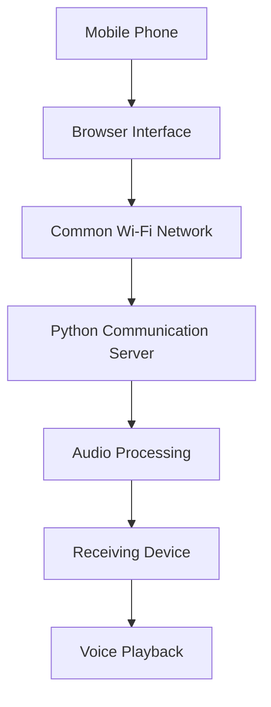
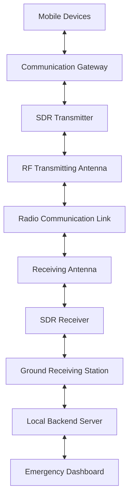

# ResQMesh – System Architecture

This document describes the current software prototype and the proposed future architecture of ResQMesh.

## 1. Current Architecture – Wi-Fi Communication Prototype

The current implementation uses a Python-based communication server to establish communication between a mobile phone and a laptop through a common Wi-Fi network.

The Python server acts as an intermediary for receiving and delivering voice messages between connected devices.

### Architecture Diagram

### Communication Workflow

1. The user records a voice message using the mobile browser.
2. The browser sends the audio data to the Python server.
3. The server receives and processes the audio.
4. The processed audio is made available to the receiving device.
5. The receiving device retrieves and plays the voice message.

### Current System Components

| Component | Responsibility |
|---|---|
| Mobile Phone | Records and sends voice messages |
| Laptop | Hosts the Python server |
| Wi-Fi Network | Connects the devices |
| Browser Interface | Provides the user interface |
| Python Server | Handles communication requests |
| Audio Processing | Processes voice data |

### Current Limitations

- Devices require a reachable common Wi-Fi network.
- The current system depends on the local network infrastructure.
- It does not provide direct RF communication.
- It does not use physical SDR transmitter or receiver hardware.
- It is an initial software prototype, not a complete walkie-talkie system.

---

## 2. Proposed Architecture – Dedicated Radio Communication Network

The future objective is to develop a dedicated communication network that allows multiple devices to exchange voice and emergency information without depending on conventional cellular infrastructure.

The proposed architecture will integrate communication gateways, SDR-based radio equipment, antennas, and a ground receiving station.

### Proposed Architecture Diagram

### Proposed Communication Workflow

1. A user sends voice or emergency information through a mobile device.
2. A communication gateway transfers the information to the radio communication system.
3. The SDR transmitter processes and modulates the digital information.
4. The transmitting antenna radiates the RF signal.
5. The receiving antenna captures the transmitted signal.
6. The SDR receiver demodulates the signal and recovers the digital information.
7. The ground receiving station forwards the recovered information to the local backend.
8. The backend makes the information available to the receiving devices or emergency dashboard.

Two-way communication will require suitable transmitting and receiving capabilities at both ends.

---

## 3. Floating Communication Module

A floating communication module is proposed as an additional radio relay point.

The concept is a compact inflatable floating structure, similar to a swimming tube, with a central waterproof equipment enclosure and an approximately 3-metre antenna mast.

### Proposed Components

| Component | Purpose |
|---|---|
| Inflatable Floating Body | Keeps the module afloat |
| Waterproof Enclosure | Protects electronic components |
| SDR Equipment | Processes radio signals |
| Antenna Mast | Supports the antenna above the water |
| RF Antenna | Transmits and receives radio signals |
| Battery | Supplies electrical power |
| Anchoring System | Helps maintain the deployment position |

### Proposed Relay Concept

The floating module is intended to act as an intermediate communication relay between communication gateways and a ground receiving station.

Its exact placement, radio links, and relay configuration will depend on the final hardware design.

---

## 4. Technologies Involved

| Technology | Function |
|---|---|
| Python | Backend communication server |
| Wi-Fi | Current prototype connectivity |
| Digital Signal Processing | Processing digital audio and signals |
| SDR | Software-configurable radio signal processing |
| BPSK | Digital modulation technique |
| RF Transmitter | Generates and transmits radio signals |
| RF Receiver | Receives and processes radio signals |
| Antenna | Converts between electrical RF signals and electromagnetic waves |

---

## 5. Development Status

| Component | Status |
|---|---|
| Python Communication Server | Implemented |
| Mobile-to-Laptop Wi-Fi Communication | Prototype working |
| Voice Message Transfer | Prototype implemented |
| Dedicated Radio Network | Planned |
| SDR Integration | Planned |
| Physical RF Transmission | Not implemented |
| Floating Communication Module | Design concept |
| Ground Receiving Station | Planned |
| Emergency Dashboard | Planned |

---

## 6. Future Development Direction

The development will progress through the following stages:

1. Improve the existing Python communication server.
2. Develop reliable communication between multiple devices.
3. Implement a suitable communication protocol.
4. Experiment with SDR-based transmission and reception.
5. Establish a physical RF communication link.
6. Develop the floating communication module.
7. Integrate the floating relay with a ground receiving station.
8. Test communication reliability and operating range.

All physical radio experiments will follow applicable radio-frequency allocation and transmission regulations.

---

**Note:** The proposed radio architecture and floating communication module are future development concepts. They should not be interpreted as currently operational hardware.
