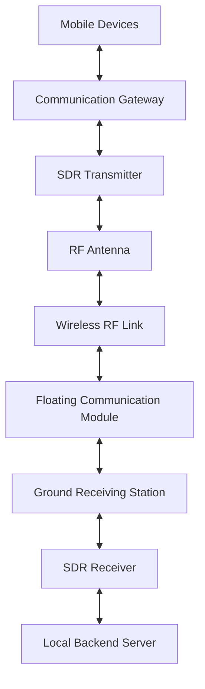

# ResQMesh – Proposed Hardware Design

## 1. Introduction

The long-term objective of ResQMesh is to develop a dedicated radio communication system for emergency situations where conventional cellular infrastructure may become unavailable.

The proposed hardware architecture consists of SDR-based transmitters and receivers, RF antennas, communication gateways, and a water-based floating communication module.

The hardware design is currently at the conceptual stage.

---

## 2. Overall Hardware Architecture

The proposed system will contain three major components:

1. Mobile Communication Interface.
2. Floating Radio Communication Module.
3. Ground Receiving Station.

### Proposed Architecture

This is a conceptual architecture. The final arrangement of transmitters, receivers, and antennas will depend on the selected communication topology.

---

## 3. SDR – Software-Defined Radio

SDR stands for Software-Defined Radio.

It is a radio communication technology in which several signal-processing functions are implemented or configured through software.

### Proposed Functions

- Digital signal modulation.
- RF signal generation and processing.
- Signal reception.
- Digital demodulation.
- Recovery of transmitted information.

SDR provides flexibility to experiment with different digital communication techniques.

---

## 4. Radio Transmitter

The transmitter is responsible for converting digital information into a radio signal suitable for wireless transmission.

### Proposed Transmission Process

1. Capture voice through a microphone.
2. Convert analog audio into digital samples.
3. Encode the samples into digital data.
4. Apply a suitable digital modulation technique.
5. Generate the RF signal using SDR hardware.
6. Transmit the signal through an RF antenna.

### Main Components

- Microphone or digital data input.
- Digital processing unit.
- SDR transmitter.
- RF front-end circuitry.
- Transmitting antenna.

---

## 5. Radio Receiver

The receiver captures incoming RF signals and recovers the transmitted digital information.

### Proposed Reception Process

1. Capture incoming electromagnetic waves through an antenna.
2. Convert the received RF energy into an electrical signal.
3. Process the signal through the RF front end.
4. Use SDR processing to recover the modulated information.
5. Demodulate and decode the digital data.
6. Reconstruct the audio.
7. Play the recovered voice through a speaker.

### Main Components

- Receiving antenna.
- RF front-end circuitry.
- SDR receiver.
- Digital processing unit.
- Audio output system.

---

## 6. RF Antenna System

RF stands for Radio Frequency.

An antenna is used to transmit and receive electromagnetic waves.

In the proposed ResQMesh system, antennas will provide the wireless interface between communication devices and relay stations.

### Antenna Functions

**Transmission:**
Converts electrical RF signals into electromagnetic waves.

**Reception:**
Captures incoming electromagnetic waves and converts them into electrical signals for receiver processing.

The antenna design will depend on:

- Operating frequency.
- Antenna type.
- Antenna gain and radiation pattern.
- Polarization.
- Antenna height.
- Environmental conditions.

The proposed floating module includes an approximately 3-metre vertical antenna mast. The actual antenna dimensions will be determined according to the selected operating frequency.

---

## 7. Floating Communication Module

One of the distinctive proposed components of ResQMesh is a compact floating communication module.

The design concept resembles an inflatable swimming tube that floats on the water surface.

A central equipment enclosure will support the communication electronics, while a vertical mast will hold the antenna above the water.

### Proposed Physical Structure

| Component | Purpose |
|---|---|
| Inflatable Floating Body | Provides buoyancy |
| Central Equipment Enclosure | Houses communication electronics |
| SDR Hardware | Processes radio signals |
| RF Antenna | Transmits and receives radio signals |
| 3-Metre Antenna Mast | Supports the antenna |
| Rechargeable Battery | Supplies electrical power |
| Power Management System | Manages electrical distribution |
| Anchoring Mechanism | Reduces unwanted movement |

### Design Concept

The floating body will support the equipment while maintaining sufficient stability on the water surface.

The central enclosure will protect sensitive electronic components from water exposure.

The antenna mast will extend vertically above the floating structure to provide an elevated antenna position.

### Intended Purpose

The floating communication module is proposed as an intermediate communication relay.

It may help establish communication links between affected regions and a ground receiving station when conventional infrastructure is unavailable.

---

## 8. Ground Receiving Station

The ground receiving station is proposed as the central receiving and processing point for emergency communication.

### Planned Functions

- Receive radio transmissions.
- Recover transmitted digital information.
- Process incoming messages.
- Forward information to the local backend server.
- Make communication available to authorized rescue operators.

The station may operate using a locally hosted backend, allowing essential communication processing to continue without internet connectivity when the local network remains operational.

---

## 9. Power Management

The floating communication module will require an independent power supply.

Potential power components include:

- Rechargeable battery.
- Battery management system.
- Voltage regulation.
- Power distribution circuitry.
- Optional solar charging.

Battery capacity will need to be calculated based on the power consumption of the SDR, RF front end, controller, and other electronic components.

---

## 10. Mechanical Design and Safety Considerations

The floating module must be designed for operation in a water-based environment.

Important considerations include:

- Buoyancy and load capacity.
- Stability under wind and water movement.
- Antenna mast strength.
- Waterproof electronic enclosure.
- Corrosion-resistant materials.
- Battery and electrical safety.
- Secure anchoring.
- Recovery and maintenance procedures.

The design will require mechanical testing and controlled water-based trials before deployment.

---

## 11. Future Hardware Development

The proposed hardware development will follow these stages:

1. Research and select suitable SDR hardware.
2. Identify compatible RF transmitter and receiver components.
3. Select suitable antennas for the intended frequency.
4. Establish a controlled point-to-point radio communication link.
5. Develop two-way communication.
6. Design the floating body and equipment enclosure.
7. Integrate the communication hardware.
8. Test stability, power consumption, signal quality, and reliability.
9. Evaluate the system under controlled environmental conditions.

All RF experiments and physical transmissions must comply with applicable radio-frequency regulations.

---

## 12. Current Development Status

| Hardware Component | Status |
|---|---|
| Python Communication Server | Implemented |
| Wi-Fi Communication Prototype | Working prototype |
| SDR Transmitter | Planned |
| SDR Receiver | Planned |
| RF Antenna System | Planned |
| Physical Radio Communication | Not implemented |
| Floating Communication Module | Design concept |
| Ground Receiving Station | Planned |
| Independent Power System | Planned |

---

## Note

This document describes the proposed hardware architecture of ResQMesh.

The SDR-based radio communication system, physical RF transmission, floating module, and ground receiving station have not yet been constructed or tested.

The hardware design remains subject to technical research, component selection, regulatory compliance, mechanical design, and practical validation.
