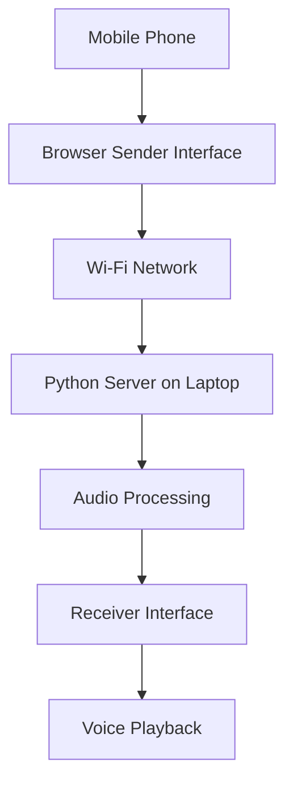

# ResQMesh – Prototype Workflow

## 1. Overview

The current ResQMesh prototype demonstrates communication between a mobile phone and a laptop using a common Wi-Fi network.

A Python-based server runs on the laptop and acts as the central communication point between connected devices.

The prototype focuses on demonstrating voice-message exchange through a local network.

## 2. System Requirements

- Laptop or computer running Python.
- Mobile phone with a modern web browser.
- Both devices connected to the same Wi-Fi network.
- Python and the required dependencies installed.
- Microphone access enabled in the browser.

## 3. Prototype Architecture



## 4. How Communication Works

### Step 1 – Server Initialization

The Python communication server runs on the laptop and listens for incoming requests.

### Step 2 – Device Connection

The mobile phone and laptop connect to the same Wi-Fi network.

The mobile browser accesses the server using the laptop's local IP address and the configured server port.

### Step 3 – Voice Recording

The sender opens the communication interface and records a voice message using the device microphone.

### Step 4 – Audio Transfer

The browser sends the recorded audio to the Python server through an HTTP request.

### Step 5 – Server Processing

The Python server receives the audio and processes it according to the implemented workflow.

### Step 6 – Audio Retrieval

The receiving device accesses the available audio through the server.

### Step 7 – Voice Playback

The receiver plays the retrieved voice message through its speaker.

## 5. Running the Prototype

### Step 1 – Clone the Repository

```bash
git clone <YOUR_GITHUB_REPOSITORY_URL>
cd ResQMesh
```

### Step 2 – Create a Virtual Environment

```bash
python -m venv venv
```

Activate it on Windows:

```bash
venv\Scripts\activate
```

### Step 3 – Install Dependencies

```bash
pip install -r requirements.txt
```

### Step 4 – Start the Python Server

Run the appropriate server entry-point file from your project.

For example:

```bash
python resqlink_server.py
```

Use the actual filename and command from your current project.

### Step 5 – Connect the Mobile Phone

1. Connect your laptop and mobile phone to the same Wi-Fi network.
2. Find the laptop's local IPv4 address.
3. Open the server address in the mobile browser using the configured port.
4. Open the sender and receiver interfaces as required.

Example address:

```text
http://192.168.1.100:8000
```

Replace the example IP address and port with your actual server configuration.

## 6. Current Prototype Limitations

- Communication requires a reachable common Wi-Fi network.
- The server must remain running on the laptop.
- Devices must be able to access the laptop's local IP address.
- Browser microphone access requires appropriate permissions and may require a secure context such as HTTPS.
- The prototype does not provide direct radio communication.
- It does not currently operate as an independent walkie-talkie network.

## 7. Current vs Future Implementation

| Capability | Current Prototype | Future Goal |
|---|---|---|
| Communication | Wi-Fi | Dedicated radio network |
| Server | Python local server | Local backend and radio gateways |
| Voice transfer | Voice messages | Two-way radio voice communication |
| Devices | Mobile and laptop | Multiple communication devices |
| Signal transmission | Network data | Physical RF transmission |
| Radio hardware | Not integrated | SDR transmitter and receiver |
| Antenna | Not used | RF transmitting and receiving antenna |
| Floating module | Not implemented | Water-based communication relay |

## 8. Important Note

This prototype demonstrates software-based communication over a common Wi-Fi network.

It should not be confused with the proposed SDR-based radio communication system. Physical RF transmission, dedicated radio hardware, and the floating communication module remain future development goals.
